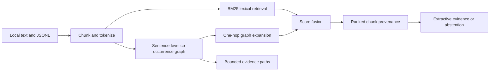

<div align="center">

# 🕸️ GraphRack (GraphRAG)

### Make every retrieval traceable.

**A local-first, explainable evidence-graph retrieval toolkit for research and RAG applications.**
[](https://github.com/tejas-sarnaik/GraphRack/actions/workflows/ci.yml)
[](https://www.python.org/)
[](LICENSE)
[](CONTRIBUTING.md)

**[Quickstart](#quickstart) · [How it works](#how-it-works) · [Commands](#cli-reference) · [Research](docs/RESEARCH.md) · [Roadmap](ROADMAP.md)**
</div>

> **Status:** v0.1.0 research prototype. Real executable code; no paid APIs or external database required. This is *not* a verified question-answering system or state-of-the-art retrieval benchmark.

## Why GraphRack?

Most retrieval demos stop at *"Here are the top five chunks."* GraphRack goes one step further: **which terms and graph connections brought each source into context, and which source supports each edge?**

GraphRack combines a transparent lexical BM25 score with a bounded evidence-graph expansion score. It surfaces chunk-level provenance and can show short entity paths for inspection. Unlike some graph pipelines, GraphRack's graph is explicitly a **heuristic keyword co-occurrence graph**, not a factual knowledge graph extracted by an LLM.

## Features

- 🕸️ **Evidence graph:** deterministic keyword nodes, sentence-level co-occurrence edges, supporting chunk IDs
- 🔎 **Hybrid ranking:** normalized BM25 and graph neighborhood expansion
- 🔗 **Explainable bridges:** bounded shortest paths with per-hop source references
- 📎 **Source-backed extraction:** extractive evidence with chunk citations (not generated answers)
- 🛑 **Basic abstention:** insufficient-evidence status when retrieval is empty or below a configurable threshold
- 🧪 **Evaluation:** Precision@k, Recall@k, MRR@k from labeled chunk references
- 🔒 **Local-first:** standard-library runtime, no credentials, telemetry, vector DB, or remote calls
- 🛠️ **Developer ready:** CLI, Python API, fixtures, unit tests, CI, contribution templates

## Quickstart

Requires Python 3.10 or newer.

```bash
python -m pip install -e .
graphrack index examples/docs --out index.json
graphrack ask "Which benchmark evaluates Aurora?" --index index.json
graphrack search "Aurora benchmark" --index index.json
graphrack bridge aurora atlas --index index.json
graphrack eval examples/questions.jsonl --index index.json --top-k 3
```

No install route: `PYTHONPATH=src python -m graphrack index examples/docs --out index.json` (POSIX shell).

### Python API

```python
from graphrack import GraphRack

rack = (GraphRack()
    .add_document("paper-1", "Aurora was developed by Aster Research.")
    .add_document("paper-2", "Aurora was evaluated on the Atlas benchmark."))

print(rack.search("Aurora benchmark", top_k=2))
print(rack.ask("Who developed Aurora?"))
print(rack.bridge("aurora", "aster"))
rack.save("index.json")
```

## How it works



Let $$b_i(q)$$ denote BM25 over chunk $$i$$, $$g_i(q)$$ the query-keyword neighborhood support, and $$λ ∈ [0,1]$$ the expansion weight. Ranking uses:

$$
\mathrm{score}(i,q) = (1-\lambda)\frac{b_i(q)}{\max_j b_j(q)} + \lambda g_i(q)
$$

If all BM25 scores are zero, the implementation uses divisor 1. Every graph edge has a set of source chunk IDs. **Graph edges represent same-sentence keyword co-occurrence, not verified subject–predicate–object facts.** See [research notes](docs/RESEARCH.md).

## CLI reference

| Command | Example | Output |
|---|---|---|
| `index` | `graphrack index examples/docs --out index.json` | Reproducible local index |
| `search` | `graphrack search "Aurora" --index index.json` | Scored chunks and matches |
| `ask` | `graphrack ask "Who developed Aurora?" --index index.json` | Extractive passage + citation |
| `bridge` | `graphrack bridge aurora atlas --index index.json` | Source-labeled entity paths |
| `graph` | `graphrack graph --index index.json --out graph.json` | Nodes + edges + provenance |
| `eval` | `graphrack eval examples/questions.jsonl --index index.json` | Retrieval metrics |

Input: UTF-8 `.txt`, `.md`, or `.jsonl` with `{"id":"unique-id", "text":"..."}` per line. Directory inputs are processed in sorted order; IDs must be unique. Local `.json` indexes are plain-text and can contain sensitive source material; do not commit private indexes.

## Reproduce evaluation

```bash
python -m pip install -e '.[dev]'
pytest -q
python -m compileall -q src tests

graphrack index examples/docs --out index.json
graphrack eval examples/questions.jsonl --index index.json --top-k 3
```

The included three synthetic questions are **smoke-test fixtures**, not evidence of generalization. To compare retrieval methods, use disjoint held-out labeled datasets, report per-query confidence intervals and latency, and include BM25-only (`expansion=0`) and graph-augmented configurations.

## Project layout

```text
src/graphrack/   # Index, graph, lexical scoring, CLI and evaluation
examples/        # Small synthetic documents and labeled queries
tests/           # Unit and regression tests
docs/            # Research notes, limitations and security
.github/         # GitHub Actions and issue templates
```

## What's different and what's not

The project emphasizes **interpretable path provenance and zero-dependency experimentation**. Entity spotting is a naive multilingual-Unicode-compatible token heuristic; it lacks named-entity disambiguation. No GPU or generative LLM is required, but it does **not** implement dense embeddings, real relation extraction, semantic entailment or reliable answer verification. Evaluation improvements are a research question, not a demonstrated claim.

## References

- [Microsoft GraphRAG](https://github.com/microsoft/graphrag) - hierarchical, graph-centered retrieval
- [HippoRAG](https://github.com/OSU-NLP-Group/HippoRAG) - graph memory and personalized PageRank
- [BM25](https://en.wikipedia.org/wiki/Okapi_BM25) - lexical relevance baseline

## Contributing

See [CONTRIBUTING.md](CONTRIBUTING.md), [CODE_OF_CONDUCT.md](CODE_OF_CONDUCT.md), and [SECURITY.md](SECURITY.md). Bugs, real datasets, benchmarks and documented PRs are welcome.

## License

This project is licensed under the [MIT License](LICENSE).

## Issues and Contributions

Bug reports, feature requests, and suggestions are welcome. Please [open an issue](https://github.com/tejas-sarnaik/GraphRack/issues) in the GitHub repository.

## Contact

Questions or issues? File an issue or contact [Tejas Sarnaik](mailto:tejassarnaik2120@gmail.com).

---

**Copyright © 2026 Tejas Sarnaik.** All rights reserved except as permitted under the MIT License.
